<!-- SPDX-FileCopyrightText: Copyright (c) 2026 NVIDIA CORPORATION & AFFILIATES. All rights reserved. -->
<!-- SPDX-License-Identifier: Apache-2.0 -->

# SimFoundry 完整 Pipeline 与 Demo 讲解指南

本文依据 **2026-10-08 当前本地工作区**的入口脚本、配置、模型封装、阶段实现和 `Data/radio_scene_capture/` 产物编写。包含尚未提交的本地 Qwen、FLUX 和 reviewed masks 扩展。讨论的是这份代码实际如何工作；不把 README 中的论文展示效果当作本机已验证结果。

本次仅阅读代码及已有结果，没有重新运行重建、机器人控制或策略训练。

## 1. 一句话介绍

**SimFoundry 把真实场景视频转化为由独立物体组成、带碰撞与物理属性、能在 OmniGibson 中加载的仿真场景，再支持物体变体、场景采样、任务描述和机器人应用。**

它输出的不只是图片或点云，而是可复用的物体资产和场景状态。核心思路是把基础模型产生的语义、图像和几何结果，与显式坐标变换、物体配准、资产转换及物理稳定化连接起来。

适合 demo 的一句英文：

> SimFoundry converts real-world video into object-level, physics-ready simulation assets and scenes, with optional augmentation and robot applications.

## 2. 总体结构与流程图


图中物体缩略图是概念示意，实际 radio 场景截图见第 9 节。图的三栏是讲解分组，与 A/B/C 的代码目录并非一一对应：前两栏共同解释 A，第三栏解释 B/C。虚线标注表示可选功能；B/C 也无需全部运行。

| 子流程 | 解决的问题 | 输入 | 核心输出 |
|---|---|---|---|
| A — Reconstruction | 怎样从真实视频得到可仿真场景？ | 视频或 ZED 双目采集 | 深度、物体 masks、纹理网格、位姿、URDF、USD、场景 JSON |
| B — Augmentation | 怎样从一个场景得到多样的物体、布局和任务？ | A 的图像、资产和场景 | digital cousins、场景变体、任务 YAML |
| C — Application | 怎样使用场景开展机器人实验？ | 场景、任务、机器人及相应控制配置 | smoke 视频、遥操作数据、评估结果；可选示范生成与回放 |

以下 Mermaid 是可编辑、可核对的数据依赖版本：

```mermaid
flowchart LR
    V[真实视频 / ZED 双目] --> D[深度与相机几何]
    D --> F[关键帧 + 支撑平面 + 世界坐标]
    F --> S[逐物体分解]
    S --> U[物体图像补全 / 增强]
    U --> M[纹理 3D 网格生成]
    S --> P[尺度与位姿匹配]
    M --> P
    P --> K[场景编译 + 碰撞 + 物理属性 + URDF]
    P -. 可选关节重建 .-> J[部件 / 关节 / articulated URDF]
    J --> K
    K --> Q[PyBullet 稳定化]
    Q --> X[USD 导入 + OmniGibson 场景]
    X --> E[场景检查 / 编辑]
    X --> B[物体 cousins + 场景变体]
    B --> T[任务 YAML]
    E --> C[Smoke / 遥操作 / 策略评估]
    T --> C
    C -. 源示范 .-> W[标注 + 物体相对 waypoints]
    W --> G[示范生成 + 回放 / 数据导出]
    F -. 可选背景分支 .-> BG[前景移除 + 背景 Gaussian Splat]
    BG -. 对齐并合并 .-> X
```



**最重要的理解：视频中的多帧首先提供几何和相机信息；A 的物体级主线随后主要围绕一张 canonical frame 展开。** 每个物体的网格主要由该帧上的物体图像生成，再利用观测深度恢复尺度和位姿。因此，这不是把每个物体的所有视频视角直接融合成精确 CAD 的流程。

## 3. 输入、坐标与运行入口

### 3.1 输入视频怎样拍

仓库建议：物体位于同一平面；相机斜向下看向台面；沿场景横向移动产生视差；让物体始终完整可见；有关节的物体尽量闭合。只站在原地旋转相机，几何约束会不足。

默认 `s1_video.n_subsampled_frames=15`。`s1_video.splat_prep=true` 是可选背景流程使用的统一帧预处理模式，不是普通 15 帧重建默认设置。

### 3.2 三个入口

```bash
cd /home/tingting/Documents/SimFoundry

bash scripts/pipeline/A_reconstruction/run.sh --help
bash scripts/pipeline/B_augmentation/run.sh --help
bash scripts/pipeline/C_application/run.sh --help
```

`scripts/pipeline/run.sh` 是统一分发入口。Shell wrapper 收集参数，调用对应 `run_*.py`，由 `simfoundry/pipeline/orchestrator.py` 组织阶段、切换环境、传递 Hydra overrides 并记录结果。

`--include` 选阶段，`--exclude` 排除阶段，`--dry-run` 查看执行计划；`--` 后是配置覆盖。选择某个后续阶段不会自动替你补齐其前置产物。

### 3.3 坐标约定

场景采用米、Z-up，四元数采用 XYZW，单位旋转为 `[0, 0, 0, 1]`。生成模型的物体局部坐标与场景坐标并不相同；A8 会显式规范化与转换，不能把网格的“正面 +Z”理解成场景重力方向。

单目深度的尺度是模型推断和后续配准的结果，不是视频提供的实测计量真值。若 demo 涉及精确装配，应通过已知尺寸或外部标定检查尺度。

## 4. A：从视频到仿真场景

默认视频计划为 **1b → 2 → 3 → 4 → 5 → 6 → 7 → 8 → 10 → 11 → 12 → 13 → 14**，共 13 个主线步骤。编号 9 是可选 articulation；1a 是双目输入的替代入口；2c 是可选背景 splat。不要把“13 个默认步骤”说成“编号只到 13”。

### A1：视频预处理或双目采集

**输入：** 原视频，或连接的 ZED 相机。

视频入口 `1b_process_raw_video.py` 解码与采样，生成 `s1_video/frames_*` 和 `input_video.mp4`。双目入口 `1a_take_stereo_images.py` 生成 `s1_zed/`。

**目的：** 给后续阶段提供稳定、对应关系明确的图像集合。

**Demo 说法：**“首先将短视频整理成少量代表性帧，保持相机移动带来的几何信息。”

### A2：深度和相机几何

`2_run_depth.py` 选择后端：视频默认 DA3（Depth Anything 3），双目可走 FoundationStereo。DA3 路径写入 `s2_da/da/exports/npz/results.npz`，包含图像、深度、置信度、内参和外参；FoundationStereo 写入 `s2_fs/`。

深度和内参将二维像素反投影为三维点：

\[
\mathbf p_{cam}=d(u,v)K^{-1}[u,v,1]^T.
\]

长序列可切块推理，通过重叠帧和 Sim(3) 对齐合并；默认 15 帧一般不触发切块。DA3 的相机几何也可供背景分支使用，但主线 A4 的世界对齐直接围绕选定相机帧的深度和支撑面构造。

**Demo 说法：**“二维画面先获得几何解释：不仅知道物体在哪里，还能得到表面点云和相机参数。”

### A3：选 canonical frame，分割并拟合支撑面

默认 `s3_ground.img_idx=auto`。`frame_selection.py` 综合物体覆盖、分离程度、清晰度、支撑面覆盖和拟合质量筛选候选帧；默认 hybrid 先做启发式筛选，再让 VLM 从 shortlist 选择。VLM 不可用时可退回启发式选择；若全部候选不满足门槛，会报告失败原因。

SAM3 先按 `desk/table/counter` 等类别寻找支撑面；必要时走 VLM 提示或交互路径。对应深度点使用 RANSAC 拟合平面，得到法向与原点。

主要输出为 `s3_ground/` 的支撑面信息；自动选帧时还输出 `frame_selection.json` 与调试图。固定索引的运行不应假定一定有自动选帧报告。

**作用：** 后续分解、物体图像和位姿都依赖这张帧。它同时提供重力对齐依据。

### A4：统一世界坐标

`4_unify_world_frame.py` 反投影关键帧、裁掉无效或过远的点、执行点云去噪，并把支撑面原点和法向变成仿真坐标基准。

其变换是先平移、再旋转：

\[
\mathbf p_{world}=R(\mathbf p_{cam}-\mathbf o),\qquad
T_{cam\to world}=T_R T_{-o}.
\]

保存 `s4_frame/image_<idx>_cam2world.npy` 和相关 `.ply`。顺序非常重要：平移量属于相机坐标，不能直接替换成未经旋转的世界平移。

**Demo 说法：**“我们将倾斜的相机视角转成 Z 轴朝上的统一场景，让之后的几何与重力一致。”

### A5：逐物体分解与遮挡处理——核心环节

`5_decompose_scene.py` 不是对原图做一次分割就结束，而是维护一个不断更新的 RGB、深度和点云状态。

一次迭代的主要动作如下：

1. VLM 提供物体类别、位置提示，SAM3 输出实例 masks；可选 reviewed instances 使用审核后的有序 masks。
2. 通过深度、凸包和支撑层次等几何关系决定移除优先级，优先处理上层、前景和没有上方物体依赖的实例，逐步显露遮挡区域。
3. 保存物体 mask、透明背景裁剪、带背景裁剪、类别和对应点云信息。
4. 用图像编辑模型移除当前物体并补绘原来被遮挡的区域。默认 Gemini 图像后端，本地可选 FLUX Kontext。
5. 对新图像预测几何深度，结合 PriorDepthAnything 和未被移除区域的旧深度约束，补全移除区域的深度。
6. 用更新后的 RGB、深度和点云处理下一个物体。

可简写为：

\[
(I_k,D_k)\xrightarrow{\text{detect/segment}}M_k
\xrightarrow{\text{remove/inpaint}}I_{k+1}
\xrightarrow{\text{depth update}}D_{k+1}.
\]

新深度不是无条件替换整张旧深度。代码将移除区域的先验置零，再把补全结果填回缺失区域，保留其它区域的原有深度。

输出集中在 `s5_scene/`：`masked_object/`、`post_object_removal/`、`metric_depth/`、`obj_cat_list/` 等。`iter_N` 是移除迭代身份；可能有 skipped iteration，因此不能假设编号连续，或每个对象都来自原始第 0 次图像。`base_iter` 记录对象依赖的迭代状态。

代码会检查物体是否可能是补绘“想象”出来的内容，但不是完全可靠的质量保证；尤其当前默认 `s6_upsample.include_invalid=true`，A6 可以继续处理 A5 标为无效的对象。

**Demo 说法：**“场景按物体逐层拆开。每拆走一个物体，就补上露出来的图像和深度，为后面的物体提供更干净的证据。”

### A6：物体图像补全、增强与去背景

`6_upsample_object_images.py` 读取 A5 物体裁剪，调整图像比例，调用 Gemini/GPT/FLUX 图像后端生成更适合 image-to-3D 的物体图像，并去除背景。局部 FLUX 分支使用针对物体的补全与保持提示；这不仅是确定性的插值放大。

配置中的单独 `infill` 是可选项；不要说每次运行都先执行独立 infill。`check_valid` 控制可选 VLM 有效性检查，当前默认关闭。

主要输出 `s6_upsample/padded/`、`infilled/`、`upsampled/`、`validity/`。

**风险与解释：** 补全提升可生成性，也可能改变物体细节。背面和遮挡部分应称为模型补全，不应称为真实扫描得到的精确几何。

### A7：生成带纹理的三维网格

`7_generate_object_meshes.py` 使用 `mesh_generator.py` 的统一接口，执行 shape generation 与 texture generation。默认 Hunyuan；可选 TRELLIS.2、Pixal3D，通常 shape 与 texture 后端应匹配。

共同输出形式：`s7_mesh/textured_mesh/<backend>/iter_N_mesh.glb`。这使后续阶段主要依赖统一产物，而不需要绑定某一个生成模型。

`s7_mesh.low_vram=true` 控制相应后端的低显存策略。具体预算依赖后端、输入和机器，不能把调度器配置的估算值当作实际峰值。

**Demo 说法：**“每个干净的二维物体图像变成独立的带纹理三维资产。”

### A8：恢复尺度、位姿和规范化物体坐标

网格生成模型输出的大小和朝向未必与真实场景一致。`8_match_object_poses.py` 将物体 mask 对应的观测点云，与生成网格采样得到的点集匹配。

主要过程是 OBB 对角线粗尺度估计、多初始方向下的 CPD 点集配准、允许或固定尺度的候选比较，以及基于最近邻距离的候选排序。默认再调用 FoundationPose，用 RGB、深度、内参和 mask 对位姿进行注册/细化。不要把这一实现笼统说成纯 ICP。

得到的对象变换可写成：

\[
\mathbf p_{world}=sR\mathbf p_{object}+\mathbf t.
\]

还可用 VLM 选择物体正面，使局部网格方向一致。对于把输入相机倾斜烘焙进网格的 pixel-aligned 后端，代码可以有条件地校正 fitted tilt；默认 `auto` 主要针对 Pixal3D，不能把所有后端都当作要强行烘焙倾斜。

输出 `s8_pose/canonical_mesh/`、`info/` 和拟合可视化。尺度的一部分可能已经烘焙进 canonical mesh，后续 A11 必须按照元信息处理，避免重复缩放。

**Demo 说法：**“生成网格解决形状，深度配准解决它在原场景中的实际大小、方向和位置。”

### A9：可选关节重建

显式开启 `--detect-articulation`，并安装可用的 articulate-anything 依赖与环境，才会加入该阶段；缺少依赖时调度器警告并跳过。

`9_articulate_objects.py` 对有关节的物体做部件分解、结构与关节推断，产出部件网格、`results/mobility.urdf`、物理信息和可选人工修正。关节类型、轴、pivot、范围与物理参数可通过交互界面审核。

A11 对 articulated 对象优先使用该工作流给出的物理信息；用户 `physics_overrides.json` 的修正优先。此分支不是由普通单体网格自动“天然获得”关节。

### A10：场景编译

`10_compile_scene.py` 读取统一场景点云、坐标变换和 A8 位姿，将每个 canonical mesh 放回共同场景，并提供编译与可视化检查。可配置使用交互修正后的位姿。

它仍然是几何层面的装配；输出或成功标记位于 `s10_compile/`。不能把这一阶段说成已经完成物理资产创建。

### A11：生成 simulation-ready 物体

`11_make_objects_sim_ready.py` 与 `asset_conversion_utils.py` 将视觉网格转换为可加载的仿真物体：按已有尺度信息转换、构建视觉与碰撞几何、分解凸碰撞体、估计质量与摩擦，并导出 URDF 及必要网格和纹理。

刚体的物理参数来自图像、类别、包围盒/体积等信息的 VLM 推断；有关节的对象则优先继承 A9 的结果和修正。`coacd`/`convex` 是可选碰撞策略，radio 记录使用 `coacd`。

`s11_sim/scene_objects_info.json` 是后续关键索引，记录 `iter_N` 到类别、模型标识和摩擦等信息的映射。质量等属性也写入对应资产，不应期待这个索引 JSON 包含全部物理信息。

**视觉网格用于渲染，碰撞网格用于接触计算。** 两者可以不同；漂亮的 GLB 本身不等于可用的机器人交互资产。

**Demo 说法：**“这一步给三维外观加上碰撞体和物理属性，变成能被模拟器使用的资产。”

### A12：PyBullet 物理稳定化

`12_stabilize_physics.py` 按拟合位姿载入 URDF 和支撑面，在重力与碰撞下运行，观察平移和旋转变化，直到满足稳定条件或达到步数限制。

主要输出 `s12_physics/pb_scene_poses.json`，位姿以世界支撑面为参考，供 A14 使用。它修正浮空、轻微穿插及不稳定初始位置，但不会证明质量、摩擦或装配关系与真实系统完全一致。

### A13：导入 USD 资产

`13_import_usd.py` 将 URDF 及视觉、碰撞、物理数据导入 USD，并处理材质、纹理与资产目录。

当前布局包括 `s13_usd/` 产物和 OmniGibson 数据集中的 `real2sim-assets/objects/<category>/<model>/` 条目。场景 JSON 的加载依赖这些资产；只拷贝 JSON 通常不足以在另一台机器恢复场景。

### A14：创建最终 OmniGibson 场景

`14_create_og_scene.py` 读取物体索引、A12 稳定化位姿和已导入 USD，创建 OmniGibson 环境，配置地面、可选桌子/机器人/背景、摩擦和外部相机，在最终模拟器中继续稳定并保存结果。

核心产物：

- `s14_og/reconstructed_og_scene.json`：可恢复的场景状态及对象引用。
- `s14_og/reconstructed_scene.png`：渲染预览。
- `s14_og/settled_poses.json`：最终阶段记录的稳定化位姿。

可选 `auto_generation` 进一步采样布局；这不是生成最基本场景的必要条件。

**Demo 说法：**“最终得到的是可加载、可渲染、可执行物理 step 的场景，并可配置机器人和传感器。”

## 5. B：对象、布局和任务增强

Digital twin 是对应真实实例与布局的重建场景；digital cousin 是在一定语义或功能约束下变化的对象资产，而非保证几何相同的复制品。

| B 阶段 | 处理 | 产物 |
|---|---|---|
| B1 | VLM 提出 geometry/topology/appearance 变化，图像模型生成 cousin 图像，并可检查合理性 | `prompt_cousin_structured/` |
| B2 | 选择哪些对象被替换、如何组合多个 cousin | `cousins_combination/combinations.json` |
| B3 | cousin 图像转成纹理网格 | `cousin_generation/` |
| B4 | 碰撞、物理属性、URDF 转换，必要时保持原始 mass/friction | `sim_cousins/` |
| B5 | cousin URDF 导入 USD | `usd_cousins/` 和数据集资产 |
| B6 | 将 cousin 替换到场景，并采样布局、运行物理检查 | `s14_og/auto_generation/` |
| B7 | VLM 根据场景提出操作任务，转成程序可读 YAML 与 predicates | `proposed_tasks/*.yaml` |
| B8，可选 | 基础物体与 cousin 的点对应匹配 | `cousin_p2p_match/` |

`6b_sample_asset_scene.py` 是已有资产场景的另一条布局采样路径，不在默认 B1–B7 顺序里。

任务 YAML 区分：初始化放置、目标条件、过程 milestone。仓库支持 `OnTopAABB`、`InsideAABB`、`AboveAABB`、`Lifted` 等状态；重建对象常用 AABB 状态避免依赖不可靠的接触/采样假设。AABB 是近似，不等于精确曲面包含或真实装配成功。

B wrapper 覆盖了一些 YAML 大默认值，例如限制最多 2 个对象、少量组合与任务，用于小规模运行。想解释实际数量，应以 wrapper、CLI overrides 和该次输出为准。

**Demo 说法：**“一个重建场景可以继续扩展成不同物体、不同布局和不同目标，作为机器人学习与评估的环境来源。”

## 6. C：仿真应用与示范数据路径

| 模式/阶段 | 做什么 | 所需额外输入 |
|---|---|---|
| `smoke-random` / smoke | 加载场景、执行随机动作并保存视频，检查最基本的运行能力 | 可加载场景和机器人配置 |
| `eval` / C1 | 调用策略客户端运行评估 | task YAML、外部策略服务/checkpoint、传感器和动作约定 |
| C2 | 遥操作并采集源示范 | 人、控制设备、任务配置 |
| C3、C3b | 标注与修正 pick/place/open/close 等子任务 | 源示范及人工标注 |
| C4 | 提取末端相对物体或 link 的 waypoints | 子任务标注和轨迹 |
| C5 | 选择源子轨迹，将物体相对 waypoints 迁移到新布局并执行，按成功条件筛选 | waypoints、环境配置、有效任务 |
| C6 | 回放并重新采集观测，支持数据导出与可选域随机化 | 已有 HDF5 示范和回放配置 |

`--mode demo` 调度 `2,3,3b,4,5,6`；`--mode full` 调度 `1,2,3,3b,4,5,6`，并不包含 smoke。`demo` 模式会涉及遥操作和人工标注，不能理解成无人值守地训练一个策略。

Waypoint 迁移的基本关系是：

\[
T_{object\to eef}=T_{world\to object}^{-1}T_{world\to eef},\qquad
T'_{world\to eef}=T'_{world\to object}T_{object\to eef}.
\]

这表示记录“末端相对物体怎样运动”，而不是固定复制世界坐标轨迹。实现还支持子任务 KNN 选择、动作噪声、重采样和成功筛选等配置。

回放支持 RGB、proprio、可选深度和 PointBridge 点云，并通过 OmniGibson wrapper 导出 LeRobot 数据；可选材质、光照和相机随机化增加观测多样性。

**发布状态需要准确说明：** README 仍注明训练/数据生成发布未完成，但当前本地树中已经有 C4–C6 的具体实现。本文据代码解释这些路径，不据此声称它们在 radio 案例已经运行，也不声称这里包含完整的策略训练入口。`--mode eval` 是使用已有策略做评估；没有对应的 `--mode train`。

## 7. 可选背景与人工编辑

### 7.1 两条背景路径

A 的 `--bg-splat` 加入 A2c：Nerfstudio 处理视频、训练并导出 Gaussian Splat，写到 `s2c_gs/`。训练出 splat 与正确接入 A14 是不同步骤，仍需对应配置和对齐资产。

更完整的 `auto_bg_reconstruction/` add-on 使用统一的 splat-prep 帧：生成前景 masks → VOID 两轮视频补绘 → 在清理后的帧上运行 DA3 → 建 seed 点云 → 训练带深度约束的 splat → 对齐 OG 世界 → 导出场景资产 bundle。

不能混用不同视频帧集合或不同 DA3 运行的尺度。该 add-on README 列出 `image_0_cam2world.npy` 作为要求，而 A 支持选其它关键帧；若切换关键帧，需要核对背景入口的索引与对齐假设。

**Gaussian Splat 通常是视觉背景，不提供物体落地的碰撞面。** 需要显式地面或其它碰撞支撑。radio 当前没有运行该背景分支。

### 7.2 两个编辑器

轻量浏览器编辑器位于 `scripts/interactive/light_editor/`，使用 USD→glTF 代理和 three.js，适合检查、移动与缩放物体、调整相机、绑定任务和导出 bundle。OmniGibson 编辑器提供实际模拟器的渲染与物理检查。

后续使用的是保存后的场景 JSON。移动或缩放物体应改 JSON，不能直接重写共享 USD 资产来移动它。重定位后应清零速度；物理确认后再发布最新版本。

编辑器记录的质量与关节范围并非所有消费者加载时都自动应用；`AGENTS.md` 明确说明，消费者需在加载后设置相应 link mass 和 joint limits。摩擦、关节位置则有现成的加载契约。demo 不应将“面板能编辑”直接等同于“所有运行入口已生效”。

## 8. 当前本地扩展怎样接入

### 8.1 本地 Qwen：替换文字/视觉推理

`simfoundry/models/text_vlm.py` 的 `create_text_vlm()` 根据环境变量选择后端，默认 Gemini，`SIMFOUNDRY_TEXT_VLM=qwen` 使用本地 Qwen3.5。

```bash
export SIMFOUNDRY_TEXT_VLM=qwen
export SIMFOUNDRY_QWEN_MODEL_PATH=/absolute/path/to/Qwen3.5-4B
export SIMFOUNDRY_QWEN_PYTHON=/absolute/path/to/qwen-env/bin/python
# 可选量化，需本地环境已安装对应依赖：
export SIMFOUNDRY_QWEN_QUANTIZATION=nf4
```

影响 canonical frame 的 VLM 选择、支撑面 fallback、物体类别识别、可选有效性检查、物体正面判断及质量/摩擦估计等接入点。worker 采用本地文件、离线加载、独立子进程，调用结束释放模型显存。

Qwen 只产生文本推理结果，不生成 A5 的移除图或 A6 的物体图。也不自动替换 B 的所有模型、articulate-anything 内部模型或 VOID 背景流程。独立 worker 的显存不被 streaming scheduler 单独预算。

阶段 JSON 仍可能保留 `gemini-...` 的配置名，因为模型选择由环境变量完成；**仅看该字符串不能判定实际文字推理 provider**。目前 radio 的 stage_info 没有完整记录这项环境选择，本文不将其视为可从该字段独立重放的历史事实。

### 8.2 本地 FLUX：替换图像编辑

```text
s5_scene.removal_model=flux
s6_upsample.model=flux
```

可用 `SIMFOUNDRY_FLUX_QUANTIZATION=nf4` 对 transformer 和 T5 做可选量化，保留 CPU offload。A5 的 FLUX 路径使用 outline/bbox 提示；当前 radio 记录为 `[outline,bbox]`，并关闭初始 source upsample。

这些扩展让一部分服务调用可在本地完成，但不等于整个仓库所有分支已完全离线。

### 8.3 审核后的 SAM3 masks

`s5_scene.reviewed_instances` 指向包含物体名、顺序、mask 路径和 provenance 的 JSON。`reviewed_instances.py` 检查源图 RGB 像素 SHA-256、mask 尺寸、非空性和物体名字。

这可以避免工作站中薄板、线缆、治具等对象被自动类别拆分错误。但它加入了审核，不应对这个具体案例宣称“无需任何人工或 agent 干预”。manifest 记录的是 agent 审核 SAM3 masks，不能将其改称人工逐像素标注。

## 9. radio_scene_capture：现有结果如何得到

### 9.1 已有产物与实际配置

| 项目 | 本地证据 / 实际值 |
|---|---|
| 输入 | `Data/radio_scene_capture/input/videos/scene.MOV` |
| 视频长度 | `review/video_metadata.json`：约 11.41 秒，684 帧 |
| A1/A2 输入帧 | stage_info 记录 15 帧；review contact sheet 的采样条目是另一组预览采样，不应混为 pipeline 输入帧 |
| Canonical frame | 固定 `s3_ground.img_idx=0`，不是默认自动选择路径 |
| 几何 | DA3，处理分辨率参数 448；已有验证记录深度为 `[15,252,448]` |
| 对象分解 | 15 个有序审核实例；`review/reviewed_instances/instances.json` |
| A5 图像编辑 | FLUX；不先放大原图；`boundary_proportion=0`；outline/bbox 提示 |
| A6 | FLUX；`check_valid=false` |
| A7 | Hunyuan shape + texture；`low_vram=true`；15 jobs，无失败记录 |
| A8 | FoundationPose 开启，正面规范化开启 |
| A9 | 未启用，没有关节重建输出 |
| A11 | CoACD；`scene_objects_info.json` 中 15 个对象 |
| A12–A14 | 保存成功标记、稳定化位姿、USD 和最终场景 |
| 最终 A14 场景 | `num_objects=15`；包含 FrankaPanda；不含额外 table 或 GS；关闭自动布局采样 |
| 展示视频 | `demo/turntable.mp4` |
| 应用测试 | `application_smoke/random_action_smoke.mp4`；日志记录 smoke 阶段完成 |

stage_info 的成功标记表示阶段完成过；不能单独证明每个物体的几何、材质与物理参数都准确。

实际对象按移除顺序包括：橙柄螺丝刀、带线扬声器模块、带线电池架模块、无线电电路板模块、白色扬声器网罩与圈、6 块灰色外壳板、3 个带紧固件的白色装配治具，以及黑色打孔工装底板。mask manifest 明确把固定的截断机器人立柱和室内家具作为背景；螺钉归入治具，网罩和外圈归为一个组件。

这种分组是**对象级重建的建模选择**，不代表系统已经识别出可拆卸的每一颗螺钉或每段柔性线缆。radio 的线缆在该流程中属于对应刚体视觉/碰撞资产，不是经过验证的柔性线缆仿真。

### 9.2 可展示的真实素材

- [视频预览 contact sheet](../Data/radio_scene_capture/review/contact_sheet.jpg)
- [审核实例 overlay](../Data/radio_scene_capture/review/reviewed_instances_overlay.png)
- [A5 物体裁剪预览](../Data/radio_scene_capture/review/stage5_crops_current.jpg)
- [最终场景 PNG](../Data/radio_scene_capture/s14_og/reconstructed_scene.png)
- [Turntable MP4](../Data/radio_scene_capture/demo/turntable.mp4)
- [随机动作 smoke MP4](../Data/radio_scene_capture/application_smoke/random_action_smoke.mp4)

当前预览图中部分纹理和亮度仍需调整；结果可以用来说明物体级资产与仿真集成，不宜将该截图称为已达到精确装配质量。

`s14_og/` 还存在 `scene_props_only.json`、`scene_robot_front_edge.json`、`scene_xarm6.json` 和 `xarm6_robot_spec.json`。这些是额外场景变体，不应混同默认 A14 的 FrankaPanda 结果；已有文件本身也不能证明 xArm 已完成控制、接触或策略评估验证。

### 9.3 时间怎样准确解释

`pipeline_timing.log` 和 `logs/stage5_reviewed.log` 记录：A1–A4 约 51.8 秒；使用审核实例的 A5 运行约 9 分 8.6 秒；A6–A14 的顺序运行约 50 分 43 秒，另有 A14 重跑和 smoke。

**不能把 50 分 43 秒称为整个案例端到端耗时。** 它只是一次 A6–A14 调用，未含前处理、A5、mask 审核、环境准备和重试。上述三段已记录的主线耗时相加约为 60 分 43 秒，但这是分段耗时之和，仍不是含审核、准备和重跑的完整端到端测量。README 的“under an hour”是项目概括，不能直接代替这个案例的完整测量。

### 9.4 当前案例能力边界

已有证据支持：视频→15 个对象资产→稳定化→USD→OmniGibson 场景，以及一次随机动作 smoke 和展示视频。

目前该 scene 目录没有 B 的 cousins/任务输出、C 的遥操作示范/waypoints/生成训练数据，也没有策略训练或成功率评估产物。随机动作测试只能证明基本加载和 step，不证明抓取、精密装配或 sim-to-real 成功。

## 10. Demo 讲稿与演示顺序

### 10.1 约一分钟讲稿

“我们希望把真实工作台变成机器人能使用的仿真环境。SimFoundry 先从短视频估计深度和相机几何，再确定一张关键帧和支撑平面。

接下来系统按物体逐层分解场景：识别一个物体、保存它的图像和几何信息，再移除并补全被遮挡的区域。每个物体图像通过三维生成模型变成纹理网格，用观测深度恢复实际尺度和位姿。

随后生成碰撞体、估计物理参数、导出 URDF，经过物理稳定化后导入 USD，最终组装成 OmniGibson 场景。

这次 radio 工作台得到了 15 个物体资产，已保存场景和随机动作 smoke 视频。它使用审核过的 SAM3 masks 和本地 FLUX 编辑。物体变体、任务生成以及策略评估是后续可接入的分支，不是这次 demo 已完成的训练结果。”

### 10.2 约五分钟演示安排

| 时间 | 展示内容 | 讲解重点 |
|---|---|---|
| 0:00–0:30 | 原视频或 contact sheet | 输入是一个真实工作台短视频 |
| 0:30–1:10 | 本文流程示意图 | 多帧几何 → 单帧物体分解 → 资产与仿真 |
| 1:10–2:00 | masks overlay、A5 crops | 15 个对象怎样定义，为什么逐层移除，说明审核路径 |
| 2:00–2:50 | A6 物体图、A7 GLB、A8 fit 图 | 生成形状与恢复尺度/位姿是不同步骤 |
| 2:50–3:40 | 最终场景与 turntable | 视觉、碰撞、物理、场景状态共同组成结果 |
| 3:40–4:20 | smoke 视频 | 已通过基本运行测试，尚未展示任务成功 |
| 4:20–5:00 | 图中 B/C 分支 | 可扩展 cousins、布局、任务、数据和策略评估 |

现场演示可直接使用已有视频。流程图里的概念缩略图与实验截图应分开展示。

### 10.3 常见问题的回答

**为什么既要深度模型又要 3D 生成模型？** 深度提供可见表面的空间约束；生成模型补全完整形状和纹理；配准把它们连接起来。

**这是不是精确扫描？** 不是精确计量意义上的扫描。遮挡和背面来自模型先验，物理参数也包含估计。

**为什么需要物理稳定化？** 独立物体的拟合误差会产生悬浮和穿插；接触与重力有助于获得更可用的初始场景。

**是否完全自动？** 默认主线以自动化为目标，但这个 radio 案例明确使用 agent 审核实例 masks；编辑和任务标注也可能需要人。

**是否训练了新模型？** A 主要调用已有模型推理和工具转换；可选背景 splat 会针对场景优化；这里没有完成 radio 策略训练。

**一张流程图能否证明机器人任务成功？** 不能。任务成功必须通过具体控制策略、任务条件和多次 episode 的评估记录说明。

## 11. 运行与复现模板

以下命令用于说明调用方式，本次没有执行。使用新 scene name 避免覆盖现有 demo 产物；复现还需要安装环境、模型、服务凭据和匹配资产路径。

### 11.1 默认视频重建

```bash
cd /home/tingting/Documents/SimFoundry
bash scripts/pipeline/A_reconstruction/run.sh \
  --scene-name demo_reconstruction_new \
  --video-fpath /absolute/path/to/video.mov \
  -- s7_mesh.low_vram=true
```

Shell wrapper 默认开启 A5–A8 streaming；`--no-stream` 改为逐阶段运行。生成模型、SAM3、深度后端与仿真器分布在不同环境，`--exec-mode direct` 只有在当前 Python 确实满足所选阶段依赖时才合适。

### 11.2 radio 路径的配置说明

该案例分多次运行、审核、重跑和补加机器人完成。下面是关键设置模板，不是已核验的单命令历史复现；审核 mask 与对应源图 hash 必须一致：

```bash
bash scripts/pipeline/A_reconstruction/run.sh \
  --scene-name radio_scene_reproduction_new \
  --video-fpath /absolute/path/to/scene.MOV \
  --no-stream \
  -- s1_video.n_subsampled_frames=15 \
     s3_ground.img_idx=0 \
     s5_scene.reviewed_instances=/absolute/path/to/reviewed_instances/instances.json \
     s5_scene.removal_model=flux \
     s5_scene.use_upsampled_source_image=false \
     s5_scene.boundary_proportion=0 \
     's5_scene.obj_removal_prompt_order=[outline,bbox]' \
     s6_upsample.model=flux \
     s7_mesh.low_vram=true \
     s14_og.include_robot=true \
     s14_og.include_table=false \
     s14_og.include_gs=false \
     s14_og.auto_generation=false \
     s14_og.randomize_xy_range=0 \
     s14_og.randomize_z_rotation_deg=0
```

如启用本地文字 VLM，先设置第 8 节的 Qwen 环境变量。仅复现图像和场景配置并不能保证与原运行完全相同，模型版本、采样设置、输入 hashes 和推理 provider 都应记录。

### 11.3 B/C 与编辑器入口

```bash
bash scripts/pipeline/B_augmentation/run.sh \
  --scene-name demo_reconstruction_new

bash scripts/pipeline/C_application/run.sh \
  --scene-name demo_reconstruction_new --mode smoke-random

# 评估需另行提供正确的 task、策略服务与机器人配置：
bash scripts/pipeline/C_application/run.sh \
  --scene-name demo_reconstruction_new --mode eval --dry-run

# 在独立的轻量编辑器环境中运行：
mamba run -n simfoundry-editor python scripts/interactive/light_editor/server.py \
  --scene /home/tingting/Documents/SimFoundry/Data/radio_scene_capture/s14_og/reconstructed_og_scene.json
```

浏览器地址通常为 `http://localhost:8770`。打开现有场景用于审核不会自动证明物理或机器人行为有效。

### 11.4 中间产物、缓存与恢复

常用目录顺序为 `s1_video → s2_da/s2_fs → s3_ground → s4_frame → s5_scene → s6_upsample → s7_mesh → s8_pose → [s9_articulate_objects] → s10_compile → s11_sim → s12_physics → s13_usd → s14_og`。

`stage_info.json` 记录阶段完成状态；`pipeline_timing.log` 记录调用耗时；`pipeline_manifest.json` 统计产物。manifest 可能在后续人工编辑或重跑后变旧。例如现有 manifest 的 mesh 文件数为 16，而 A7 job 数和最终对象数为 15：文件统计与对象数不是同一个量。

`--skip-successful` 仅跳过“曾经成功”的阶段，不检测上游是否改变。切换关键帧、mask 顺序、后端或尺度后，应重新运行所有受影响阶段，不能把旧成功标记当作依赖缓存有效性证明。

`--cache-mode` 保存模型原始响应；`--test-mode` 回放已有缓存。后者不是免模型、免资产依赖的完整仿真测试，也不表示任务成功。

Streaming 允许 A5 输出某个对象后 A6/A7/A8 跟进，依靠按对象的产物检查、原子写入和 GPU 内存预算协调。它改变调度与资源使用，不改变“每个物体仍须按依赖顺序处理”的逻辑。

## 12. 代码与证据索引

以下 `file:line` 以写作时的本地文件为准，便于 demo 前追查实现。相对链接用于直接打开文件。

| 主题 | 代码 / 文档定位 |
|---|---|
| A/B/C 实际阶段计划 | [orchestrator.py](../simfoundry/pipeline/orchestrator.py)，`get_reconstruction_stage_plan`（约 156）、`get_augmentation_stage_plan`（约 208）、`get_application_stage_plan`（约 226） |
| 默认和可选参数 | [real2sim_cfg.yaml](../scripts/cfg/real2sim_cfg.yaml)，A 参数从约 26 行起；另见各 `run.sh` 的 wrapper overrides |
| 关键帧与支撑平面 | [3_segment_ground_plane.py](../scripts/pipeline/A_reconstruction/stages/3_segment_ground_plane.py):179；[frame_selection.py](../simfoundry/pipeline/frame_selection.py) |
| 世界变换 | [4_unify_world_frame.py](../scripts/pipeline/A_reconstruction/stages/4_unify_world_frame.py):41 |
| 移除顺序与更新深度 | [5_decompose_scene.py](../scripts/pipeline/A_reconstruction/stages/5_decompose_scene.py):337；约 1931 行为深度更新 |
| 图像准备 | [6_upsample_object_images.py](../scripts/pipeline/A_reconstruction/stages/6_upsample_object_images.py):65 |
| 网格生成接口 | [mesh_generator.py](../simfoundry/models/mesh_generator.py):156 |
| CPD、FoundationPose 与尺度 | [8_match_object_poses.py](../scripts/pipeline/A_reconstruction/stages/8_match_object_poses.py):297；约 465、680 行 |
| articulation | [9_articulate_objects.py](../scripts/pipeline/A_reconstruction/stages/9_articulate_objects.py)；[articulation_physics.py](../simfoundry/pipeline/articulation_physics.py) |
| 碰撞、质量与 URDF | [11_make_objects_sim_ready.py](../scripts/pipeline/A_reconstruction/stages/11_make_objects_sim_ready.py):262；[asset_conversion_utils.py](../simfoundry/utils/asset_conversion_utils.py):640 |
| 两次模拟器集成 | [12_stabilize_physics.py](../scripts/pipeline/A_reconstruction/stages/12_stabilize_physics.py):120；[14_create_og_scene.py](../scripts/pipeline/A_reconstruction/stages/14_create_og_scene.py):155 |
| 任务 proposal / predicates | [7_propose_scene_tasks.py](../scripts/pipeline/B_augmentation/stages/7_propose_scene_tasks.py)；[predicates.py](../simfoundry/tasks/predicates.py) |
| C 模式真实映射 | [run_application.py](../scripts/pipeline/C_application/run_application.py):15 |
| Waypoints 与示范生成 | [annotation_utils.py](../simfoundry/utils/annotation_utils.py):1187；[5_generate_demos.py](../scripts/pipeline/C_application/stages/5_generate_demos.py):394 |
| Qwen 和审核扩展 | [LOCAL_QWEN.md](LOCAL_QWEN.md)；[text_vlm.py](../simfoundry/models/text_vlm.py):8；[reviewed_instances.py](../simfoundry/pipeline/reviewed_instances.py):12 |
| 背景 add-on | [auto-background README](../scripts/pipeline/A_reconstruction/stages/auto_bg_reconstruction/README.md) |
| 场景编辑与保存契约 | [AGENTS.md](../AGENTS.md)；[编辑器使用说明](INSTRUCTIONS_SCENE_EDITOR.md) |
| radio 实际阶段记录 | [s14 stage_info](../Data/radio_scene_capture/s14_og/stage_info.json)；其它 `s*/stage_info.json` |
| radio 实例定义 | [instances.json](../Data/radio_scene_capture/review/reviewed_instances/instances.json) |
| radio 时间与产物统计 | [pipeline_timing.log](../Data/radio_scene_capture/pipeline_timing.log)；[pipeline_manifest.json](../Data/radio_scene_capture/pipeline_manifest.json) |

绘图使用内置 imagegen。完整提示词保存在 [simfoundry_pipeline_prompt.txt](assets/simfoundry_pipeline_prompt.txt)，用于解释布局、模型标注和可选路径，不作为运行配置。
